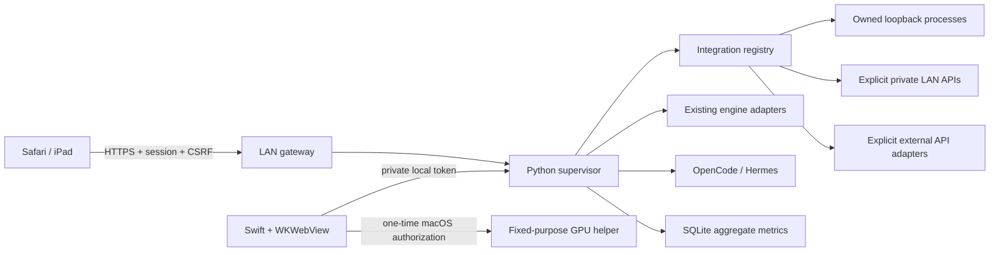

# Arquitectura / Architecture

IA Local 1.2 is a control plane with a native macOS Apple Silicon shell and a portable Windows/Linux browser launcher for existing inference installations. It does not bundle models or inference servers. The native window and authenticated web gateway serve the same `index.html`.

## Components and boundaries

| Component | Responsibility | State and failure behavior |
|---|---|---|
| `App.swift` | WKWebView, local bridge, file dialogs, helper installation | Reads its selected data directory from bundle metadata; has normal user privileges. |
| `supervisor.py` | Authenticated local HTTP, jobs, serial model lifecycle, broker, background discovery | Claims its socket before starting monitors. Agent CLI assistants run outside the model lock so their broker requests do not deadlock. |
| `core.py` | Model inventory, actual process identity, native adapters, readiness and state | Records PID, executable, birth time and argument digest. Ports are reserved and checked before unloading an existing model. |
| `integrations.py` | Reviewed local HTTP definitions and passive installation discovery | Arguments are arrays, never shell strings. Template, executable and loopback rules are checked. Model-required engines wait without weights. |
| `integration_assistant.py` | Real OpenCode/Hermes CLI with isolated local-only profile | Reads selected executable help, denies tools and cloud fallback, validates JSON. Bad output is reviewable and cannot be registered until corrected. |
| `remote_servers.py` | Private LAN API registration and remote model catalogue | Only explicitly supplied IPs on a currently connected private subnet; no redirects, SSH or remote OS process control. |
| `external_providers.py` | Opt-in OpenAI Chat Completions and Anthropic Messages adapters | HTTPS public targets use validated/pinned addresses and hostname TLS. Local FreeLLMAPI is a separate exact loopback exception protected by process identity. No automatic cloud fallback. |
| `operations.py` | Benchmarks, functional checks, optimization and agent profiles | Sequential trials, cancellation and cleanup. Benchmarks and passive inference history are separate. |
| `inference_stats.py`, `comparison.py` | Recorded inference summaries and comparable engine rows | Missing timings remain missing. Failed/unknown records do not enter successful averages. |
| `gpu_telemetry.py`, `memory_status.py` | Read-only driver/VM counters | Missing counters stay unknown; cache and RAM categories are not added together. |
| `lan.py` | HTTPS sessions, roles, CSRF, origin/host checks, TOTP, authenticated agent interfaces | Privileged administration requires an administrator and a recent second-factor check. |
| `privileged.py`, `privileged_gpu.c`, `authorize.c` | Limited local GPU sysctl helper and macOS authorization | Root helper admits only reading/setting `iogpu.wired_limit_mb`; its owner is established at authorized installation. |
| `updater.py` | Fixed official update adapters and reversible backups | Stages llama runtimes in a fresh tree to avoid symlink collisions, validates before/after swapping, restores on failure. |
| `app_settings.py` | Global preference validation | Accepts only allowlisted fields. Does not edit managed runtime state or secrets. |
| `Installer.swift`, `install_clean.py`, `build_release.py` | Offline clean installer and reproducible packaging entry points | Selected app/data directories, no overwrite of existing installations, private empty initial state. |
| `exo_local.py` | Existing single-host EXO wrapper | Requires a separately installed compatible EXO runtime. It is not universal EXO installation automation. |

## State model

Stopped → Starting → Available → Loading → Model response verified → Generating. A waiting service may have no process or weights. A listener alone is not health. A listed remote/cloud model is not proof of residency or account entitlement. External proxy readiness is explicitly called “connection ready”.

The Control UI derives enabled actions from health, process/waiting state, current jobs, selected model, context, role and available backups. It does not rely on greyed-out buttons for authorization: the server checks permissions independently.

## Data layout

Default data: `~/Library/Application Support/IA-Local`; a clean installer may select another directory. The directory is 0700 and JSON secrets/token files are 0600. Main files:

- `catalog.json`, `contexts.json`, `profiles.json`: local model metadata and tested parameters.
- `integrations.json`, `remote-servers.json`, `external-providers.json`: reviewed integration definitions, with no API keys.
- `remote-credentials.json`, `external-credentials.json`: private local key stores. These are permission-protected files, not Keychain encryption.
- `history.sqlite`: aggregate request events and benchmark results. Agent conversations remain with the agents.
- `access.sqlite`: password hashes, sessions and second-factor state.
- `processes.json`, `active.json`: managed identities and last verified active model.
- `backups/`, `results/`: reversible configuration/runtime copies and controlled evaluation evidence.

Clean release archives contain none of these personalized files. On first launch the app creates a fresh random local token and its empty databases.

## Concurrency and memory

Model loads and active benchmarks are serialized through the lifecycle lock. Only one local resident model is selected by the manager. Direct clients outside the broker are not forced into its queue. Remote/cloud execution does not create physical memory on the Mac. Remote engine OS memory/load management is not implied by Disconnect. Start all never enables external API adapters.

## Portability

The original adapters retain support for an existing Strata/M4 Pro layout. Clean setup detects only present components, starts with an empty catalogue, and supports reviewed custom HTTP adapters and explicit model folders. Missing optional Mirai/local-provider modules cannot prevent clean startup. Unknown CLI agents or engine-specific load/update APIs require an adapter and are not advertised as universally supported.

## Portable shell and reset

`portable_launcher.py` protects its per-user data directory, prepares only public assets, starts its own loopback supervisor and requests a one-use browser launch capability. `desktop_server.py` uses a random scoped session, HttpOnly/SameSite cookie, exact loopback Host/Origin and CSRF. The private root bearer never enters browser JavaScript. An authenticated LAN account remains a separate trust boundary. Windows data uses a user/SYSTEM NTFS ACL; POSIX data uses mode 0700.

`reset_state.py` snapshots allowlisted configuration and consistent SQLite backups with a SHA-256 manifest. Reset stops only unchanged managed identities, disconnects providers, clears active users/preferences and rotates the local token. It preserves programs, weights and agent conversations. Recovery first checks integrity and backs up current state; it invalidates sessions and leaves services/LAN stopped.

Native Apple adapters and iogpu are unavailable on portable systems. Custom adapters are declared compatibility until actual inference passes. GPU telemetry uses macOS driver counters or optional nvidia-smi; missing counters remain null. No universal updater or engine installer is implied by a generic integration.
